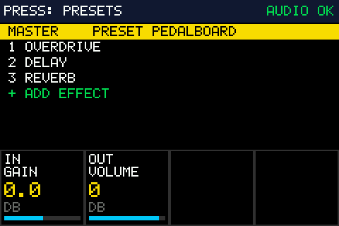
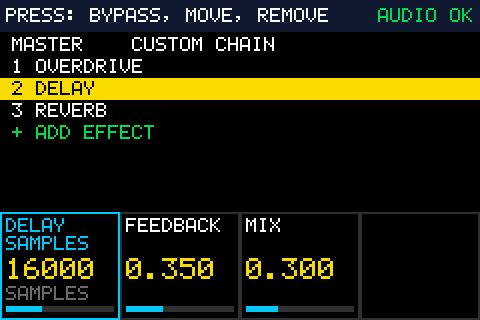
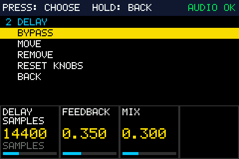
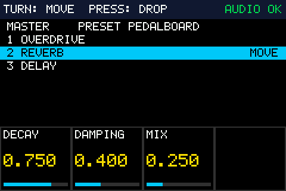
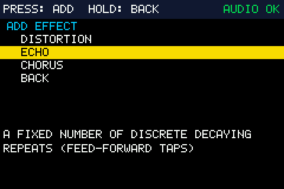
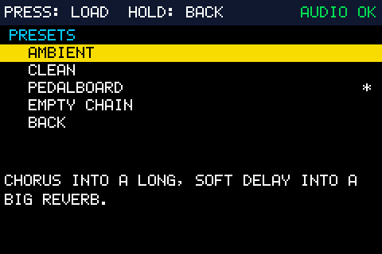

# Front panel: TFT screen and encoders

The pedal's front panel is a 3.5" 480x320 TFT and five push-encoders:
- the **main** encoder, beside the screen, moves through lists and menus;
- four **knob** encoders, under the screen, turn whatever the four boxes at the
  bottom of the screen show.



**The panel and the serial `fx>` command line are one implementation.** Every change
either one makes goes through `sw/fx_cli/chain.c` ([firmware.md](firmware.md#one-set-of-operations-chainc)),
so the rules, the checks and the patch writes are the same code. The two stay in
sync:
- Whatever you do on the panel is printed on the serial port as the command that
  does the same, for example `[panel] set delay mix=0.520` or `[panel] mv reverb 1`.
  Pasting those lines back into `fx>` rebuilds the same chain; `make -C sim ui`
  checks that.
- Whatever you type over serial appears on the screen straight away.

## Parts

- Adafruit 3.5" TFT FeatherWing, 480x320, HX8357D, SPI (product 3651)
- 5 mechanical rotary encoders with a push switch (EC11 / KY-040 style)
- A 5 V supply for the backlight
- Wires to Pmods JC, JD, JE and JF

## Wiring

### Pmod pin numbering (looking at the connector on the Zybo)

```
   ┌────┬────┬────┬────┬─────┬─────┐
   │  1 │  2 │  3 │  4 │ GND │ 3V3 │   top row:    pins 1-4, 5 = GND, 6 = 3.3 V
   ├────┼────┼────┼────┼─────┼─────┤
   │  7 │  8 │  9 │ 10 │ GND │ 3V3 │   bottom row: pins 7-10, 11 = GND, 12 = 3.3 V
   └────┴────┴────┴────┴─────┴─────┘
```

### Display: FeatherWing → Pmod JF (PS MIO)

| JF pin | Zynq pin | function | FeatherWing pin |
|---|---|---|---|
| 1 | MIO13 | SPI1 chip select (SS0) | **9** (TFT CS) |
| 2 | MIO10 | SPI1 MOSI | **MO** |
| 3 | MIO11 | SPI1 MISO | not connected |
| 4 | MIO12 | SPI1 clock | **SCK** |
| 5 | — | GND | **GND** |
| 6 | — | 3.3 V | **3V** |
| 7 | MIO0 | GPIO: data/command | **10** (TFT DC) |
| 8 | MIO9 | GPIO: reset | **RST** |
| 9, 10 | MIO14, MIO15 | taken by SPI1 (SS1, SS2) | — |

**The backlight needs its own 5 V.** Wire the FeatherWing's **USB** pin to a 5 V supply
(the driver's limit is 5.5 V), with its ground joined to the Zybo's. The Pmod can't
provide it: the Zybo's Pmods only have 3.3 V. The 5 V feeds a boost converter that
drives the LEDs, and the 3.3 V from JF6 powers the display and enables that converter.
The **3V pin takes 3.3 V only**: never connect 5 V to it.

Leave every other FeatherWing pin unconnected: MI, 5 (SD CS), 6 (touch IRQ), SDA, SCL,
LITE, EN, BAT.

- **The FeatherWing's ON/OFF switch must be ON.** OFF grounds the backlight's enable
  (LITE). With no Feather attached it doesn't cut the 3.3 V, so the display stays
  powered with its backlight off.
- **MISO isn't needed:** the firmware never reads from the display. Leaving it off
  also keeps the microSD slot off the bus. Don't insert an SD card in it.
- **RST** goes only to the FeatherWing's reset button. The display's own reset comes
  from a voltage supervisor on the 3.3 V rail, and the firmware sends a software reset
  at boot. To save the pin, leave it off and set `TFT_PIN_RST` to `-1` in
  `panel_config.h`.

### Encoders → Pmods JC, JD, JE (PL, through EMIO GPIO)

Each encoder has 5 pins: **A**, **B**, **C** (common), and two switch pins.

| encoder | role | A | B | switch |
|---|---|---|---|---|
| ENC0 | knob 1 (leftmost) | JE1 | JE7 | JE8 |
| ENC1 | knob 2 | JE3 | JE9 | JE10 |
| ENC2 | knob 3 | JD1 | JD7 | JD8 |
| ENC3 | knob 4 (rightmost) | JD3 | JD9 | JD10 |
| ENC4 | **main** | JC1 | JC7 | JC2 |

Each encoder's C pin and second switch pin go to GND: pin 5 or 11 of a Pmod.

- **Bare encoders need no resistors:** the XDC turns on the FPGA's pull-ups.
- **Breakout modules** (KY-040 etc.) have their own pull-ups and a **+** pin. Connect
  it to the Pmod's **3.3 V**, never 5 V.
- **An encoder counts the wrong way?** Set its bit in `PANEL_ENC_REVERSE`
  (`panel_config.h`) instead of re-soldering A and B.
- **Wired in a different order?** `PANEL_ENC_MAIN` and `PANEL_ENC_KNOB0` say which
  encoder does what.

```
 Encoders ─► JC/JD/JE ─► PL (wires only) ─► EMIO GPIO 0-14 ─┐
                                                            ├─► ARM: fx_cli
 FeatherWing ◄── JF ◄── MIO 10-13 (SPI1) + MIO 0, 9 (GPIO) ─┘
```

Free afterwards: JA (all 8, the XADC port), JC3, JC4, JC8, JC9, JC10, JD2, JD4, JE2,
JE4.

## Controls

| control | turn | click | hold (0.6 s) |
|---|---|---|---|
| **main** | move through the list | open, choose, drop | back / cancel; on the home screen, jump to the top |
| **knob 1..4** | change the value in the box above it | more knobs, for an effect with more than four | reset that value to its default |
| **knob, pushed in while turning** | fine: a tenth of the usual step | | |

- **A knob step** is about 1% of its range, rounded to 1, 2 or 5 of the knob's unit:
  0.01 for 0..1 knobs (mix, feedback, ...), 500 samples for `delay_samples`, 0.1 Hz for
  chorus `rate`. Values always land on that grid, so they read cleanly.
- **Spinning fast** moves 5 steps per click.
- **Values stop at their limits;** they don't wrap.

## Screens

### Home: the chain

The list is the signal path, top to bottom:

| row | shows | the knobs turn | click |
|---|---|---|---|
| **MASTER** | the preset the chain matches, or `CUSTOM CHAIN` | 1: input gain (1.5 dB steps), 2: output volume (1 dB) | the preset list |
| **1, 2, ...** each stage | its effect; `BYP` and gray when bypassed | that effect's knobs | the stage menu |
| **+ ADD EFFECT** | (hidden when every effect is in the chain) | nothing | the effect picker |

The knobs are always live: select a stage and turn. No menu is needed to tweak.



Each box shows the knob's name, its value, its unit, and a bar for where it sits in
its range. A box lights up while its knob is being turned.

### Stage menu



| item | does | serial equivalent |
|---|---|---|
| BYPASS / TURN ON | takes the effect out of the signal path, keeping its settings | `bypass <fx> on` / `off` |
| MOVE | lifts the stage: turn to move it, click to drop it there | `mv <fx> <pos>` |
| REMOVE | removes it at once | `rm <fx>` |
| RESET KNOBS | every knob back to its default | `set <fx> knob=default ...` |
| BACK | | |

The knobs still turn this stage's values while the menu is open.

### Moving and adding



While moving, the stage is drawn in cyan with `MOVE`; the list shows the order it
would have. Click to drop, hold to cancel.

**+ ADD EFFECT** lists the effects not in the chain (each effect can be in it once),
with the selected one's description at the bottom. Clicking one places it like a
move, starting at the end of the chain, tagged `NEW`. Click to drop it there: it goes
in with default knobs, and the selection lands on it so the knobs are live at once.



### Presets



Every preset, with `*` on the one the chain matches; `EMPTY CHAIN` (the dry signal,
`clear`); `BACK`. The bottom shows the selected preset's description. Click loads it.

### Status bar

- **Left:** what the main encoder does here. After a change, for 2 s, what
  happened instead: `ADDED`, `REMOVED`, `BYPASSED`, an error in red (`ALREADY IN THE
  CHAIN`), or `NO AUDIO - CHANGE PENDING` when the router didn't pick the change up
  because no samples are flowing (it applies once they do).
- **Right:** the audio badge, checked 4 times a second from the router's STATUS word:
  - `AUDIO OK` (green): the heartbeat is moving;
  - `NO AUDIO`: no samples in the last 250 ms (check the codec, MCLK, LD3);
  - `OVERRUN`, `FX TMOUT`: the router's sticky flags, the same as LD0 and LD1.

## Staying in sync with the serial port

- **Panel → serial.**
  - Every change is printed as its command, prefixed `[panel]`, above the `fx>`
    prompt, and anything half-typed is put back.
  - A knob being turned is printed once it has been still for 0.3 s, with the value
    it settled on, so a sweep is one line, not fifty.
  - Values print in natural units when that text parses back to exactly the same raw
    value, and as the raw value otherwise. Every echoed line replays exactly.
- **Serial → panel.** The screen shows changes made over serial at once. A change to
  the chain while a menu is open (say, `rm` of the stage being moved) closes the menu
  and shows `CHANGED OVER SERIAL`; the selection stays on the same effect if it still
  exists. A `gain` or `vol` over serial just updates the MASTER boxes.

## Settings (`sw/fx_cli/panel_config.h`)

| setting | default | change it when |
|---|---|---|
| `TFT_SPI_PRESCALER` | `XSPIPS_CLK_PRESCALE_8` (20.8 MHz) | the picture is garbled: `_16`; short wires and you want speed: `_4` |
| `TFT_MADCTL` | `0xA0` | the screen is upside down: `0x60` |
| `TFT_PIN_RST` | `9` | RST isn't wired: `-1` |
| `PANEL_ENC_MAIN`, `PANEL_ENC_KNOB0` | `4`, `0` | the encoders are wired in another order |
| `PANEL_ENC_REVERSE` | `0x00` | an encoder counts the wrong way: set bit k for encoder k |
| `PANEL_STEPS_PER_DETENT` | `4` | it takes two clicks to move by one: `2` |
| `PANEL_POLL_HZ` | `2000` | rarely; 1000–4000 all work |

The timing of clicks and holds, steps and the echo delay are `#define`s at the top of
`sw/fx_cli/ui.c`.

## How it works

| file | role |
|---|---|
| `ui.c` / `ui.h` | the screens, the gestures, knob steps, the echo; portable |
| `lcd.c` / `lcd.h` / `lcd_hw.h` | HX8357D driver: init, rectangles, 5x7 font scaled; portable, its I/O behind `lcd_hw.h` |
| `panel.h`, `panel_config.h` | what the UI reads from the encoders; the wiring and tuning |
| `panel_zynq.c` | the board side: SPI1 and MIO GPIO for the display, EMIO GPIO for the encoders, the timer interrupt |
| `sim/host/host_panel.c` | the PC side: a framebuffer, and scripted encoder events |

- **The main loop** takes one character from the serial port and then makes one
  panel pass, forever ([firmware.md](firmware.md#main-loop)). Neither waits for the
  other.
- **A 2 kHz timer interrupt** decodes the encoders (a state-table quadrature decoder
  that ignores bounces; debounced switches), empties the UART's receive FIFO into a
  ring buffer, and counts the milliseconds the UI times clicks and holds with. Turns and keystrokes are never lost while the main loop is drawing.
- **Each panel pass** turns the gestures since the last pass into `chain_*()` calls,
  builds the whole screen as text, and redraws **one** widget that differs from what
  is on the glass (a row, a box, the status bar). One widget takes a few ms over SPI,
  so passes stay short; a full screen takes about 100 ms.
- **Without the panel hardware** in the XSA (no SPI1 or PS GPIO, an older bitstream),
  `panel_zynq.c` compiles to stubs, the boot prints `front panel NOT started`, and the
  command line works alone. With the hardware there but nothing wired, the panel runs
  with no effect: the pull-ups hold the encoders still.

## Previewing on a PC

```
make -C sim ui
```

It builds the firmware for the PC, plays scripted turns and clicks, checks the results
([verification.md](verification.md#front-panel-on-the-host)), and writes a picture of
each main screen to `build/sim/ui/*.png`. The pictures in this document come from
there; copy them to `docs/img/panel_*.png` after changing the layout.

The binary it builds, `build/sim/ui/fx_cli_host`, takes commands on stdin, plus
lines starting with `@` as panel events:

```
printf 'preset ambient\n@turn main 2\n@turn k3 5\n@wait 400\n@dump\n' | build/sim/ui/fx_cli_host
```

The events are listed at the top of `sim/host/host_panel.c`: `@turn`, `@spin`,
`@click`, `@hold`, `@pushturn`, `@wait`, `@dump` (the screen as text) and `@snap`
(the screen as an image).

## Troubleshooting

| symptom | check |
|---|---|
| boot says `front panel NOT started` | the XSA lacks SPI1 or EMIO GPIO: rebuild with `build_all --force`. Booting from SD: the card's `BOOT.BIN` is older than the hardware; copy the new `build/BOOT.BIN` to it after the rebuild |
| backlight never comes on | 5 V on the USB pin, grounds joined; 3.3 V on the 3V pin; FeatherWing switch ON |
| backlight lights, then goes dark until the 5 V is reapplied | on boards with the TPS61169 driver (with the TSC2007 touch controller), its open-LED protection latches it off. With the 5 V left on, flip the ON/OFF switch off and on: if the light returns, check the display's flex cable. If not, measure 5 V at USB and about 2.5 V at LITE |
| white screen, backlight on | SCK (JF4), MO (JF2), CS (JF1) |
| black screen, backlight on | DC (JF7) |
| speckles or wrong colors | lower the SPI clock (`_16`); shorten the wires |
| upside down | `TFT_MADCTL` = `0x60` |
| an encoder counts the wrong way | its bit in `PANEL_ENC_REVERSE` |
| an encoder moves every other click | `PANEL_STEPS_PER_DETENT` = `2` |
| an encoder never changes | its wiring; the C pin to GND; the XDC's `GPIO_0_0_tri_io` pins |
| a build error on an `XPAR_...` name | open the platform's `xparameters.h` and use the name there in `panel_zynq.c` |

## Credits

The display driver and the encoder decoder come from the `zybo-encoders-tft` sample.
The HX8357D init values come from Adafruit's
[Adafruit_HX8357 library](https://github.com/adafruit/Adafruit_HX8357_Library) (BSD
license).
